<picture><source media="(prefers-color-scheme: dark)" srcset="assets/dark/header.svg"/></picture>

<a href="https://iamekansh.netlify.app"><picture><source media="(prefers-color-scheme: dark)" srcset="https://img.shields.io/badge/PORTFOLIO-0d1117?style=flat-square&logoColor=ffffff"/></picture></a>
<a href="https://www.linkedin.com/in/iamekanshjain/"><picture><source media="(prefers-color-scheme: dark)" srcset="https://img.shields.io/badge/LINKEDIN-0d1117?style=flat-square&logo=linkedin&logoColor=ffffff"/></picture></a>
<a href="mailto:helloworldiamekansh@gmail.com"><picture><source media="(prefers-color-scheme: dark)" srcset="https://img.shields.io/badge/EMAIL-0d1117?style=flat-square"/></picture></a>

<picture><source media="(prefers-color-scheme: dark)" srcset="assets/dark/s01.svg"/></picture>
<picture><source media="(prefers-color-scheme: dark)" srcset="assets/dark/whoami.svg"/></picture>

<picture><source media="(prefers-color-scheme: dark)" srcset="assets/dark/s02.svg"/></picture>
<picture><source media="(prefers-color-scheme: dark)" srcset="assets/dark/projects.svg"/></picture>

<a href="https://github.com/Anonymous-Ekansh/Kinexis">Kinexis</a> · <a href="https://github.com/Anonymous-Ekansh/SIH26PatientCaseTaking">SIH26PatientCaseTaking</a> · <a href="https://github.com/Anonymous-Ekansh/PatientCaseTakingNew">PatientCaseTakingNew</a> · <a href="https://github.com/Anonymous-Ekansh/NLPSupportSystem">NLPSupportSystem</a> · <a href="https://github.com/Anonymous-Ekansh/FindYourRoommate">FindYourRoommate</a> · <a href="https://github.com/Anonymous-Ekansh/tedxsnioe2026-web">tedxsnioe2026-web</a> · <a href="https://github.com/Anonymous-Ekansh/bcon-website">bcon-website</a> · <a href="https://github.com/Anonymous-Ekansh/ComputeQuest-hackwave">ComputeQuest-hackwave</a> · <a href="https://github.com/Anonymous-Ekansh/PolyIntel">PolyIntel</a> · <a href="https://github.com/Anonymous-Ekansh/MealMate">MealMate</a> · <a href="https://arena.anonymous-ekansh.workers.dev/play">arena</a>

<picture><source media="(prefers-color-scheme: dark)" srcset="assets/dark/s03.svg"/></picture>

<!-- ARENA:START -->
<table width="100%" cellspacing="0" cellpadding="0" border="0"><tr>
<td valign="top" width="58%" align="center">
<picture><source media="(prefers-color-scheme: dark)" srcset="https://arena.anonymous-ekansh.workers.dev/c/header.svg?theme=dark"/></picture> <picture><source media="(prefers-color-scheme: dark)" srcset="https://arena.anonymous-ekansh.workers.dev/c/status.svg?theme=dark"/></picture> 
<a href="https://arena.anonymous-ekansh.workers.dev/c/click/a8"><picture><source media="(prefers-color-scheme: dark)" srcset="https://arena.anonymous-ekansh.workers.dev/c/tile/a8.svg?theme=dark"/></picture></a><a href="https://arena.anonymous-ekansh.workers.dev/c/click/b8"><picture><source media="(prefers-color-scheme: dark)" srcset="https://arena.anonymous-ekansh.workers.dev/c/tile/b8.svg?theme=dark"/></picture></a><a href="https://arena.anonymous-ekansh.workers.dev/c/click/c8"><picture><source media="(prefers-color-scheme: dark)" srcset="https://arena.anonymous-ekansh.workers.dev/c/tile/c8.svg?theme=dark"/></picture></a><a href="https://arena.anonymous-ekansh.workers.dev/c/click/d8"><picture><source media="(prefers-color-scheme: dark)" srcset="https://arena.anonymous-ekansh.workers.dev/c/tile/d8.svg?theme=dark"/></picture></a><a href="https://arena.anonymous-ekansh.workers.dev/c/click/e8"><picture><source media="(prefers-color-scheme: dark)" srcset="https://arena.anonymous-ekansh.workers.dev/c/tile/e8.svg?theme=dark"/></picture></a><a href="https://arena.anonymous-ekansh.workers.dev/c/click/f8"><picture><source media="(prefers-color-scheme: dark)" srcset="https://arena.anonymous-ekansh.workers.dev/c/tile/f8.svg?theme=dark"/></picture></a><a href="https://arena.anonymous-ekansh.workers.dev/c/click/g8"><picture><source media="(prefers-color-scheme: dark)" srcset="https://arena.anonymous-ekansh.workers.dev/c/tile/g8.svg?theme=dark"/></picture></a><a href="https://arena.anonymous-ekansh.workers.dev/c/click/h8"><picture><source media="(prefers-color-scheme: dark)" srcset="https://arena.anonymous-ekansh.workers.dev/c/tile/h8.svg?theme=dark"/></picture></a> <a href="https://arena.anonymous-ekansh.workers.dev/c/click/a7"><picture><source media="(prefers-color-scheme: dark)" srcset="https://arena.anonymous-ekansh.workers.dev/c/tile/a7.svg?theme=dark"/></picture></a><a href="https://arena.anonymous-ekansh.workers.dev/c/click/b7"><picture><source media="(prefers-color-scheme: dark)" srcset="https://arena.anonymous-ekansh.workers.dev/c/tile/b7.svg?theme=dark"/></picture></a><a href="https://arena.anonymous-ekansh.workers.dev/c/click/c7"><picture><source media="(prefers-color-scheme: dark)" srcset="https://arena.anonymous-ekansh.workers.dev/c/tile/c7.svg?theme=dark"/></picture></a><a href="https://arena.anonymous-ekansh.workers.dev/c/click/d7"><picture><source media="(prefers-color-scheme: dark)" srcset="https://arena.anonymous-ekansh.workers.dev/c/tile/d7.svg?theme=dark"/></picture></a><a href="https://arena.anonymous-ekansh.workers.dev/c/click/e7"><picture><source media="(prefers-color-scheme: dark)" srcset="https://arena.anonymous-ekansh.workers.dev/c/tile/e7.svg?theme=dark"/></picture></a><a href="https://arena.anonymous-ekansh.workers.dev/c/click/f7"><picture><source media="(prefers-color-scheme: dark)" srcset="https://arena.anonymous-ekansh.workers.dev/c/tile/f7.svg?theme=dark"/></picture></a><a href="https://arena.anonymous-ekansh.workers.dev/c/click/g7"><picture><source media="(prefers-color-scheme: dark)" srcset="https://arena.anonymous-ekansh.workers.dev/c/tile/g7.svg?theme=dark"/></picture></a><a href="https://arena.anonymous-ekansh.workers.dev/c/click/h7"><picture><source media="(prefers-color-scheme: dark)" srcset="https://arena.anonymous-ekansh.workers.dev/c/tile/h7.svg?theme=dark"/></picture></a> <a href="https://arena.anonymous-ekansh.workers.dev/c/click/a6"><picture><source media="(prefers-color-scheme: dark)" srcset="https://arena.anonymous-ekansh.workers.dev/c/tile/a6.svg?theme=dark"/></picture></a><a href="https://arena.anonymous-ekansh.workers.dev/c/click/b6"><picture><source media="(prefers-color-scheme: dark)" srcset="https://arena.anonymous-ekansh.workers.dev/c/tile/b6.svg?theme=dark"/></picture></a><a href="https://arena.anonymous-ekansh.workers.dev/c/click/c6"><picture><source media="(prefers-color-scheme: dark)" srcset="https://arena.anonymous-ekansh.workers.dev/c/tile/c6.svg?theme=dark"/></picture></a><a href="https://arena.anonymous-ekansh.workers.dev/c/click/d6"><picture><source media="(prefers-color-scheme: dark)" srcset="https://arena.anonymous-ekansh.workers.dev/c/tile/d6.svg?theme=dark"/></picture></a><a href="https://arena.anonymous-ekansh.workers.dev/c/click/e6"><picture><source media="(prefers-color-scheme: dark)" srcset="https://arena.anonymous-ekansh.workers.dev/c/tile/e6.svg?theme=dark"/></picture></a><a href="https://arena.anonymous-ekansh.workers.dev/c/click/f6"><picture><source media="(prefers-color-scheme: dark)" srcset="https://arena.anonymous-ekansh.workers.dev/c/tile/f6.svg?theme=dark"/></picture></a><a href="https://arena.anonymous-ekansh.workers.dev/c/click/g6"><picture><source media="(prefers-color-scheme: dark)" srcset="https://arena.anonymous-ekansh.workers.dev/c/tile/g6.svg?theme=dark"/></picture></a><a href="https://arena.anonymous-ekansh.workers.dev/c/click/h6"><picture><source media="(prefers-color-scheme: dark)" srcset="https://arena.anonymous-ekansh.workers.dev/c/tile/h6.svg?theme=dark"/></picture></a> <a href="https://arena.anonymous-ekansh.workers.dev/c/click/a5"><picture><source media="(prefers-color-scheme: dark)" srcset="https://arena.anonymous-ekansh.workers.dev/c/tile/a5.svg?theme=dark"/></picture></a><a href="https://arena.anonymous-ekansh.workers.dev/c/click/b5"><picture><source media="(prefers-color-scheme: dark)" srcset="https://arena.anonymous-ekansh.workers.dev/c/tile/b5.svg?theme=dark"/></picture></a><a href="https://arena.anonymous-ekansh.workers.dev/c/click/c5"><picture><source media="(prefers-color-scheme: dark)" srcset="https://arena.anonymous-ekansh.workers.dev/c/tile/c5.svg?theme=dark"/></picture></a><a href="https://arena.anonymous-ekansh.workers.dev/c/click/d5"><picture><source media="(prefers-color-scheme: dark)" srcset="https://arena.anonymous-ekansh.workers.dev/c/tile/d5.svg?theme=dark"/></picture></a><a href="https://arena.anonymous-ekansh.workers.dev/c/click/e5"><picture><source media="(prefers-color-scheme: dark)" srcset="https://arena.anonymous-ekansh.workers.dev/c/tile/e5.svg?theme=dark"/></picture></a><a href="https://arena.anonymous-ekansh.workers.dev/c/click/f5"><picture><source media="(prefers-color-scheme: dark)" srcset="https://arena.anonymous-ekansh.workers.dev/c/tile/f5.svg?theme=dark"/></picture></a><a href="https://arena.anonymous-ekansh.workers.dev/c/click/g5"><picture><source media="(prefers-color-scheme: dark)" srcset="https://arena.anonymous-ekansh.workers.dev/c/tile/g5.svg?theme=dark"/></picture></a><a href="https://arena.anonymous-ekansh.workers.dev/c/click/h5"><picture><source media="(prefers-color-scheme: dark)" srcset="https://arena.anonymous-ekansh.workers.dev/c/tile/h5.svg?theme=dark"/></picture></a> <a href="https://arena.anonymous-ekansh.workers.dev/c/click/a4"><picture><source media="(prefers-color-scheme: dark)" srcset="https://arena.anonymous-ekansh.workers.dev/c/tile/a4.svg?theme=dark"/></picture></a><a href="https://arena.anonymous-ekansh.workers.dev/c/click/b4"><picture><source media="(prefers-color-scheme: dark)" srcset="https://arena.anonymous-ekansh.workers.dev/c/tile/b4.svg?theme=dark"/></picture></a><a href="https://arena.anonymous-ekansh.workers.dev/c/click/c4"><picture><source media="(prefers-color-scheme: dark)" srcset="https://arena.anonymous-ekansh.workers.dev/c/tile/c4.svg?theme=dark"/></picture></a><a href="https://arena.anonymous-ekansh.workers.dev/c/click/d4"><picture><source media="(prefers-color-scheme: dark)" srcset="https://arena.anonymous-ekansh.workers.dev/c/tile/d4.svg?theme=dark"/></picture></a><a href="https://arena.anonymous-ekansh.workers.dev/c/click/e4"><picture><source media="(prefers-color-scheme: dark)" srcset="https://arena.anonymous-ekansh.workers.dev/c/tile/e4.svg?theme=dark"/></picture></a><a href="https://arena.anonymous-ekansh.workers.dev/c/click/f4"><picture><source media="(prefers-color-scheme: dark)" srcset="https://arena.anonymous-ekansh.workers.dev/c/tile/f4.svg?theme=dark"/></picture></a><a href="https://arena.anonymous-ekansh.workers.dev/c/click/g4"><picture><source media="(prefers-color-scheme: dark)" srcset="https://arena.anonymous-ekansh.workers.dev/c/tile/g4.svg?theme=dark"/></picture></a><a href="https://arena.anonymous-ekansh.workers.dev/c/click/h4"><picture><source media="(prefers-color-scheme: dark)" srcset="https://arena.anonymous-ekansh.workers.dev/c/tile/h4.svg?theme=dark"/></picture></a> <a href="https://arena.anonymous-ekansh.workers.dev/c/click/a3"><picture><source media="(prefers-color-scheme: dark)" srcset="https://arena.anonymous-ekansh.workers.dev/c/tile/a3.svg?theme=dark"/></picture></a><a href="https://arena.anonymous-ekansh.workers.dev/c/click/b3"><picture><source media="(prefers-color-scheme: dark)" srcset="https://arena.anonymous-ekansh.workers.dev/c/tile/b3.svg?theme=dark"/></picture></a><a href="https://arena.anonymous-ekansh.workers.dev/c/click/c3"><picture><source media="(prefers-color-scheme: dark)" srcset="https://arena.anonymous-ekansh.workers.dev/c/tile/c3.svg?theme=dark"/></picture></a><a href="https://arena.anonymous-ekansh.workers.dev/c/click/d3"><picture><source media="(prefers-color-scheme: dark)" srcset="https://arena.anonymous-ekansh.workers.dev/c/tile/d3.svg?theme=dark"/></picture></a><a href="https://arena.anonymous-ekansh.workers.dev/c/click/e3"><picture><source media="(prefers-color-scheme: dark)" srcset="https://arena.anonymous-ekansh.workers.dev/c/tile/e3.svg?theme=dark"/></picture></a><a href="https://arena.anonymous-ekansh.workers.dev/c/click/f3"><picture><source media="(prefers-color-scheme: dark)" srcset="https://arena.anonymous-ekansh.workers.dev/c/tile/f3.svg?theme=dark"/></picture></a><a href="https://arena.anonymous-ekansh.workers.dev/c/click/g3"><picture><source media="(prefers-color-scheme: dark)" srcset="https://arena.anonymous-ekansh.workers.dev/c/tile/g3.svg?theme=dark"/></picture></a><a href="https://arena.anonymous-ekansh.workers.dev/c/click/h3"><picture><source media="(prefers-color-scheme: dark)" srcset="https://arena.anonymous-ekansh.workers.dev/c/tile/h3.svg?theme=dark"/></picture></a> <a href="https://arena.anonymous-ekansh.workers.dev/c/click/a2"><picture><source media="(prefers-color-scheme: dark)" srcset="https://arena.anonymous-ekansh.workers.dev/c/tile/a2.svg?theme=dark"/></picture></a><a href="https://arena.anonymous-ekansh.workers.dev/c/click/b2"><picture><source media="(prefers-color-scheme: dark)" srcset="https://arena.anonymous-ekansh.workers.dev/c/tile/b2.svg?theme=dark"/></picture></a><a href="https://arena.anonymous-ekansh.workers.dev/c/click/c2"><picture><source media="(prefers-color-scheme: dark)" srcset="https://arena.anonymous-ekansh.workers.dev/c/tile/c2.svg?theme=dark"/></picture></a><a href="https://arena.anonymous-ekansh.workers.dev/c/click/d2"><picture><source media="(prefers-color-scheme: dark)" srcset="https://arena.anonymous-ekansh.workers.dev/c/tile/d2.svg?theme=dark"/></picture></a><a href="https://arena.anonymous-ekansh.workers.dev/c/click/e2"><picture><source media="(prefers-color-scheme: dark)" srcset="https://arena.anonymous-ekansh.workers.dev/c/tile/e2.svg?theme=dark"/></picture></a><a href="https://arena.anonymous-ekansh.workers.dev/c/click/f2"><picture><source media="(prefers-color-scheme: dark)" srcset="https://arena.anonymous-ekansh.workers.dev/c/tile/f2.svg?theme=dark"/></picture></a><a href="https://arena.anonymous-ekansh.workers.dev/c/click/g2"><picture><source media="(prefers-color-scheme: dark)" srcset="https://arena.anonymous-ekansh.workers.dev/c/tile/g2.svg?theme=dark"/></picture></a><a href="https://arena.anonymous-ekansh.workers.dev/c/click/h2"><picture><source media="(prefers-color-scheme: dark)" srcset="https://arena.anonymous-ekansh.workers.dev/c/tile/h2.svg?theme=dark"/></picture></a> <a href="https://arena.anonymous-ekansh.workers.dev/c/click/a1"><picture><source media="(prefers-color-scheme: dark)" srcset="https://arena.anonymous-ekansh.workers.dev/c/tile/a1.svg?theme=dark"/></picture></a><a href="https://arena.anonymous-ekansh.workers.dev/c/click/b1"><picture><source media="(prefers-color-scheme: dark)" srcset="https://arena.anonymous-ekansh.workers.dev/c/tile/b1.svg?theme=dark"/></picture></a><a href="https://arena.anonymous-ekansh.workers.dev/c/click/c1"><picture><source media="(prefers-color-scheme: dark)" srcset="https://arena.anonymous-ekansh.workers.dev/c/tile/c1.svg?theme=dark"/></picture></a><a href="https://arena.anonymous-ekansh.workers.dev/c/click/d1"><picture><source media="(prefers-color-scheme: dark)" srcset="https://arena.anonymous-ekansh.workers.dev/c/tile/d1.svg?theme=dark"/></picture></a><a href="https://arena.anonymous-ekansh.workers.dev/c/click/e1"><picture><source media="(prefers-color-scheme: dark)" srcset="https://arena.anonymous-ekansh.workers.dev/c/tile/e1.svg?theme=dark"/></picture></a><a href="https://arena.anonymous-ekansh.workers.dev/c/click/f1"><picture><source media="(prefers-color-scheme: dark)" srcset="https://arena.anonymous-ekansh.workers.dev/c/tile/f1.svg?theme=dark"/></picture></a><a href="https://arena.anonymous-ekansh.workers.dev/c/click/g1"><picture><source media="(prefers-color-scheme: dark)" srcset="https://arena.anonymous-ekansh.workers.dev/c/tile/g1.svg?theme=dark"/></picture></a><a href="https://arena.anonymous-ekansh.workers.dev/c/click/h1"><picture><source media="(prefers-color-scheme: dark)" srcset="https://arena.anonymous-ekansh.workers.dev/c/tile/h1.svg?theme=dark"/></picture></a> 
<picture><source media="(prefers-color-scheme: dark)" srcset="https://arena.anonymous-ekansh.workers.dev/c/recent.svg?theme=dark"/></picture> 
<a href="https://arena.anonymous-ekansh.workers.dev/play"><picture><source media="(prefers-color-scheme: dark)" srcset="https://arena.anonymous-ekansh.workers.dev/btn/play.svg?theme=dark"/></picture></a>
</td>
<td valign="middle" width="42%" align="center">
<picture><source media="(prefers-color-scheme: dark)" srcset="https://arena.anonymous-ekansh.workers.dev/t/header.svg?theme=dark"/></picture> 
<a href="https://arena.anonymous-ekansh.workers.dev/t/click/0"><picture><source media="(prefers-color-scheme: dark)" srcset="https://arena.anonymous-ekansh.workers.dev/t/tile/0.svg?theme=dark"/></picture></a><a href="https://arena.anonymous-ekansh.workers.dev/t/click/1"><picture><source media="(prefers-color-scheme: dark)" srcset="https://arena.anonymous-ekansh.workers.dev/t/tile/1.svg?theme=dark"/></picture></a><a href="https://arena.anonymous-ekansh.workers.dev/t/click/2"><picture><source media="(prefers-color-scheme: dark)" srcset="https://arena.anonymous-ekansh.workers.dev/t/tile/2.svg?theme=dark"/></picture></a> <a href="https://arena.anonymous-ekansh.workers.dev/t/click/3"><picture><source media="(prefers-color-scheme: dark)" srcset="https://arena.anonymous-ekansh.workers.dev/t/tile/3.svg?theme=dark"/></picture></a><a href="https://arena.anonymous-ekansh.workers.dev/t/click/4"><picture><source media="(prefers-color-scheme: dark)" srcset="https://arena.anonymous-ekansh.workers.dev/t/tile/4.svg?theme=dark"/></picture></a><a href="https://arena.anonymous-ekansh.workers.dev/t/click/5"><picture><source media="(prefers-color-scheme: dark)" srcset="https://arena.anonymous-ekansh.workers.dev/t/tile/5.svg?theme=dark"/></picture></a> <a href="https://arena.anonymous-ekansh.workers.dev/t/click/6"><picture><source media="(prefers-color-scheme: dark)" srcset="https://arena.anonymous-ekansh.workers.dev/t/tile/6.svg?theme=dark"/></picture></a><a href="https://arena.anonymous-ekansh.workers.dev/t/click/7"><picture><source media="(prefers-color-scheme: dark)" srcset="https://arena.anonymous-ekansh.workers.dev/t/tile/7.svg?theme=dark"/></picture></a><a href="https://arena.anonymous-ekansh.workers.dev/t/click/8"><picture><source media="(prefers-color-scheme: dark)" srcset="https://arena.anonymous-ekansh.workers.dev/t/tile/8.svg?theme=dark"/></picture></a> 
<picture><source media="(prefers-color-scheme: dark)" srcset="https://arena.anonymous-ekansh.workers.dev/t/status.svg?theme=dark"/></picture> 
<a href="https://arena.anonymous-ekansh.workers.dev/t/new"><picture><source media="(prefers-color-scheme: dark)" srcset="https://arena.anonymous-ekansh.workers.dev/btn/new.svg?theme=dark"/></picture></a>
</td>
</tr></table>

pieces: Cburnett, CC BY-SA 3.0

<!-- ARENA:END -->

<picture><source media="(prefers-color-scheme: dark)" srcset="assets/dark/s04.svg"/></picture>
<picture><source media="(prefers-color-scheme: dark)" srcset="assets/dark/telemetry.svg"/></picture>

<picture>
  <source media="(prefers-color-scheme: dark)" srcset="https://streak-stats.demolab.com?user=Anonymous-Ekansh&amp;theme=transparent&amp;hide_border=true&amp;ring=E6E6E6&amp;fire=E6E6E6&amp;currStreakLabel=E6E6E6&amp;currStreakNum=E6E6E6&amp;sideNums=E6E6E6&amp;sideLabels=8C8C8C&amp;dates=8C8C8C&amp;stroke=3A3A3A"/>
  
</picture>

<picture>
  <source media="(prefers-color-scheme: dark)" srcset="https://raw.githubusercontent.com/Anonymous-Ekansh/Anonymous-Ekansh/output/github-contribution-grid-snake-dark.svg"/>
  <source media="(prefers-color-scheme: light)" srcset="https://raw.githubusercontent.com/Anonymous-Ekansh/Anonymous-Ekansh/output/github-contribution-grid-snake.svg"/>
  
</picture>

<picture><source media="(prefers-color-scheme: dark)" srcset="assets/dark/s05.svg"/></picture>
<picture><source media="(prefers-color-scheme: dark)" srcset="assets/dark/experience.svg"/></picture>

<picture><source media="(prefers-color-scheme: dark)" srcset="assets/dark/s06.svg"/></picture>
<picture><source media="(prefers-color-scheme: dark)" srcset="assets/dark/stack.svg"/></picture>

<picture><source media="(prefers-color-scheme: dark)" srcset="assets/dark/s07.svg"/></picture>
<picture><source media="(prefers-color-scheme: dark)" srcset="assets/dark/focus.svg"/></picture>

<picture><source media="(prefers-color-scheme: dark)" srcset="assets/dark/footer.svg"/></picture>
